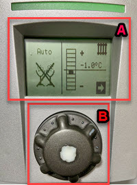
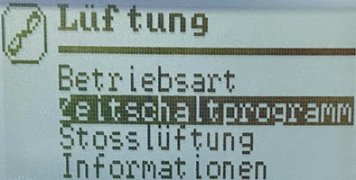
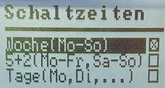

<!-- title: Wärmepumpe Alpha-Innotec -->
<!-- author: Holger Burkarth -->
<!-- version: 1.0.1 -->
<!-- date: 2026-03-02 -->

<!-- 
Ignore Spelling: hauptbildschirm
-->

# Bedienungsanleitung für die Wärmepumpe Alpha-Innotec

## Inhaltsverzeichnis
1. [Hauptbildschirm](#hauptbildschirm)
2. [Haupt-Menü](#haupt-menü)

## Hauptbildschirm

Das Bild zeigt den Hauptbildschirm der Steuerung der Wärmepumpe Alpha-Innotec. Auf dem Display werden verschiedene Informationen angezeigt,
darunter die Temperatur der Heizung und die aktuelle Betriebsart.

### ==A: Display==

#### **Mittig und rechts:**
In diesem Beispiel ist die Heizung auf -1 Grad Celsius eingestellt, das bedeutet, dass die Heizung ein Grad weniger heizt als nötig. Dadurch
wird Energie gespart, da die Heizung nicht unnötig stark heizt. Es ist wichtig, die Heizung auf die richtige Temperatur einzustellen,
um den Energieverbrauch zu optimieren und gleichzeitig den Komfort zu gewährleisten.  
> [!TIP]
> Es ist ratsam, die Temperatur der Jahreszeit entsprechend anzupassen, um den Energieverbrauch zu minimieren.

#### **Links:** Die Betriebsart steht auf "Auto", was bedeutet, dass die Wärmepumpe alles automatisch regelt.
In diesem Modus passt die Wärmepumpe die Heizleistung entsprechend den aktuellen Bedingungen an, um eine effiziente und komfortable Heizung zu gewährleisten.
Weiterhin läuft die Lüftung ebenfalls auf "Auto", was bedeutet, dass die Lüftung automatisch gesteuert wird, um eine optimale Luftzirkulation zu gewährleisten.  
> [!TIP]
> Es ist ratsam, die Betriebsart auf **"Auto"** zu belassen.

### ==B: Eingabe Drehknopf==
Der Eingabe-Drehknopf ermöglicht es dem Benutzer, verschiedene Einstellungen der Wärmepumpe zu ändern. Durch Drehen des Knopfs kann die gewünschte Option ausgewählt werden,
und durch Drücken des Knopfs wird die Auswahl bestätigt.

> [!IMPORTANT]
> - In seltenen Fällen kann es vorkommen, dass die Steuerung nicht gleich reagiert. In diesem Fall sollte der Benutzer kurz warten und wenn nötig, den Knopf erneut drücken.
> - Es muss auch darauf geachtet werden, beim Drücken des Knopfs keine weitere Drehbewegung auszuführen, da dies zu unerwünschten Änderungen führen könnte.

## ==Haupt-Menü==

Über das Hauptmenü erhalten Sie Zugriff auf verschiedene Funktionen und Einstellungen der Wärmepumpe. Hier können Benutzer die Betriebsart ändern, die Temperatur anpassen, die Lüftung steuern und weitere Einstellungen vornehmen.

Um ins Menü zu gelangen, muss der Eingabe-Drehknopf so lange langsam gedreht werden, bis das Pfeil-Symbol auf dem Display markiert ist.
Anschließend wird der Knopf gedrückt, um das Menü zu öffnen.

Aus dem Haupt-Menü können verschiedene Untermenüs aufgerufen werden, um spezifische Einstellungen vorzunehmen. Zum Beispiel können Benutzer die Betriebsart ändern,
die Temperatur anpassen oder die Lüftung steuern.  
Mit dem Eingabe-Drehknopf können die gewünschten Optionen ausgewählt und bestätigt werden.

==M1==: Informationen (sind aktuelle nicht relevant)

==M2==: Fußbodenheizung

==M3==: Warmwasser

==M4==: Lüftung

==M5==: Einstellungen und relevante Informationen

## ==M4: Lüftung==

Im Untermenü „Lüftung” können Benutzer das **Zeitschaltprogramm** für die Lüftung anpassen. Sie können auch die Betriebsart der Lüftung ändern, um diese bei
schlechter Außenluft komplett zu **deaktivieren** oder den Party-Modus zu aktivieren, um die Lüftung dauerhaft auf **maximaler Stufe** zu betreiben.
Darüber hinaus kann die Stoßlüftung aktiviert werden, um die Lüftung für ca. eine Stunde auf **maximaler Stufe** zu betreiben und die Luft schnell auszutauschen.

### Zeitschaltprogramm

Die Zeiteinstellungen ermöglichen es Benutzern, die Lüftung zu bestimmten Zeiten automatisch zu steuern. Zum Beispiel können Benutzer die Lüftung so einstellen,
dass sie während der Nacht oder zu bestimmten Tageszeiten aktiviert oder deaktiviert wird, um den Energieverbrauch zu optimieren und den Komfort zu gewährleisten.

> [!TIP]
> Es ist ratsam, die Zeiteinstellungen an die Jahreszeit und die individuellen Bedürfnisse anzupassen, um den Energieverbrauch zu minimieren und gleichzeitig
> eine angenehme Luftqualität zu gewährleisten. In den kalten Monaten kann es sinnvoll sein, die Lüftung während der Nacht zu deaktivieren,
> um Wärmeverluste zu vermeiden.

Aktuell wird für alle Wochentage ein gemeinsamer Plan verwendet. Durch die Auswahl von „Woche” können Benutzer die Zeiteinstellungen anpassen.
Wählen Sie „Woche” aus, um zur Übersicht der Zeiteinstellungen zu gelangen.

Es gibt zwei Modi: **„Täglich”** und **„Nachts”**. Der Unterschied liegt in der Stärke der Lüftung.

#### **„Täglich"-Modus**:

*Die Lüftung wird auf einer moderaten Stufe betrieben.*

#### **„Nachts"-Modus**:

*Die Lüftung wird auf einer niedrigeren Stufe betrieben, um den Geräuschpegel zu minimieren.*

> Die zwei Bilder zeigen die Einstellungen für Winter.

**Zusammenfassung:**  
Im „Täglich"-Modus gewährleistet die Lüftung eine kontinuierliche Luftzirkulation, während der „Nachts"-Modus den Geräuschpegel reduziert und gleichzeitig
eine ausreichende Luftqualität sicherstellt.

