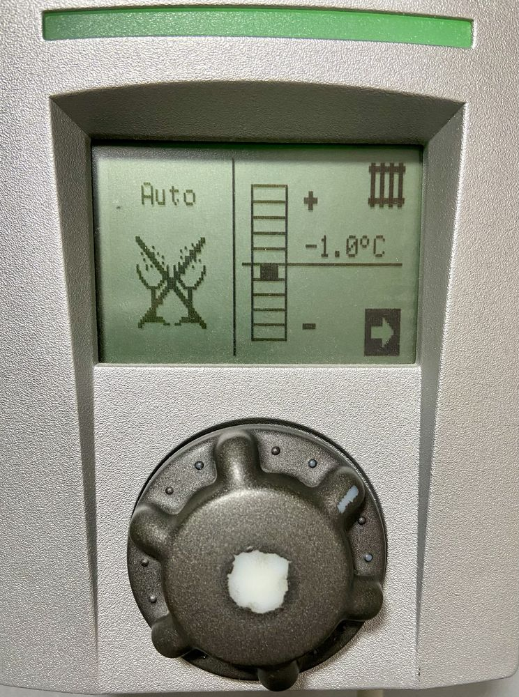
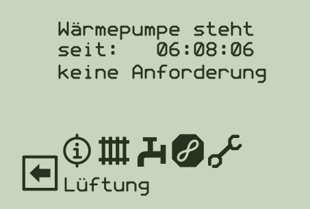
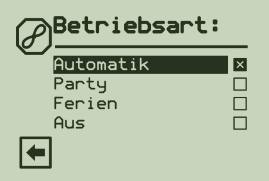
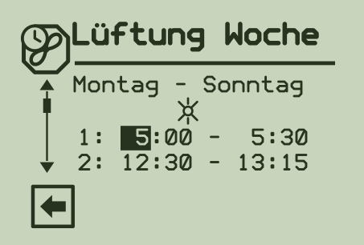
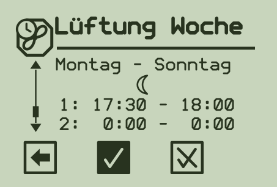
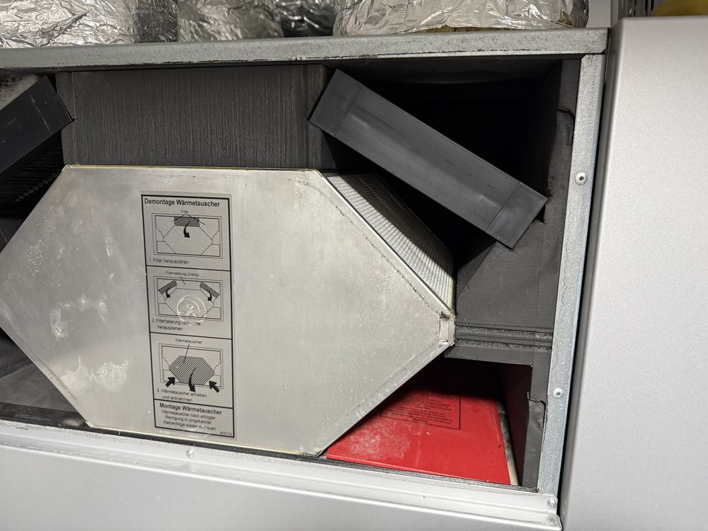
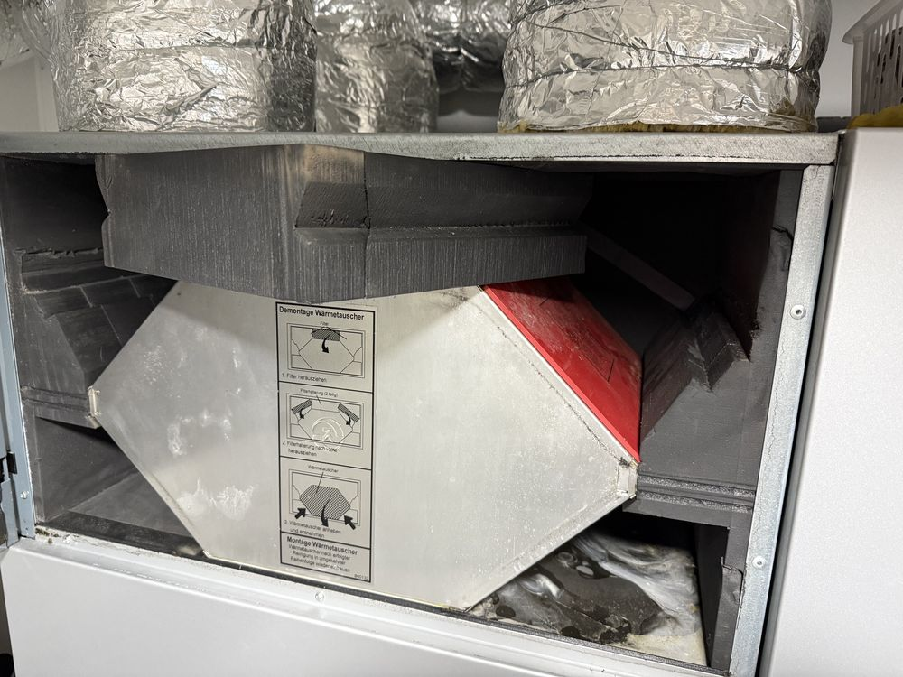
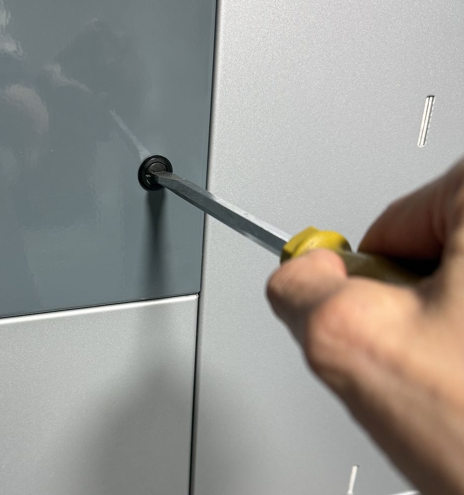
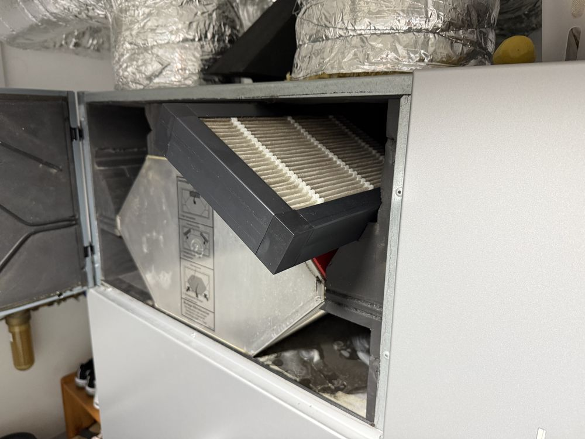
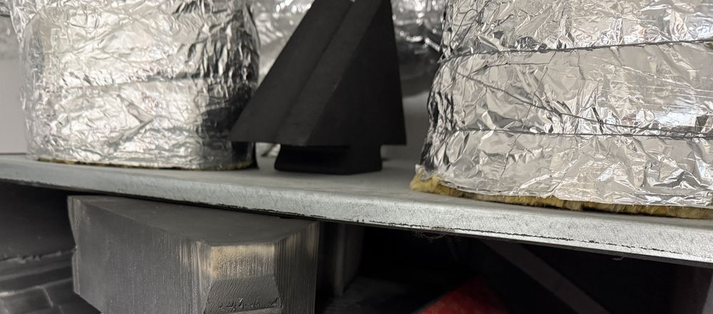

<!-- title: Wärmepumpe Alpha-Innotec – Anleitung für die Familie -->
<!-- author: Holger Burkarth -->
<!-- version: 3.0.0 -->
<!-- date: 2026-11-08 -->

<!-- 
Ignore Spelling: hauptbildschirm
-->

# Unsere Wärmepumpe mit Lüftung

**Anleitung für die Familie.** Sie ist dafür gemacht, dass ihr auch **ohne Holger** zurechtkommt. Technisches Wissen braucht ihr nicht.

**Das Wichtigste zuerst:** Die Anlage läuft von selbst. Im Alltag müsst ihr nichts tun. Sie arbeitet am günstigsten und schonendsten, wenn man sie in Ruhe lässt.

- [Auf einen Blick](#auf-einen-blick)
- [Wenn etwas nicht stimmt](#wenn-etwas-nicht-stimmt)
- [Durchs Jahr](#durchs-jahr)
- [Bedienung](#bedienung)
- [Lüftung umbauen: Winter und Sommer](#lüftung-umbauen-winter-und-sommer)

## Auf einen Blick

**So sieht es normal aus:** Links in der Anzeige steht **Auto**. Rechts steht ein kleiner Wert, zum Beispiel −1.0°C.

**Der Drehknopf** sitzt unter der Anzeige. **Drehen** wählt aus, **Drücken** bestätigt. Passiert nichts, kurz warten und noch einmal drücken. Das ist bei dieser Steuerung normal.

| Was ist los? | Was du tust |
|---|---|
| **Zu kalt oder zu warm** | Den Wert rechts **einen** Schritt ändern: **[+]** wärmer, **[−]** kühler. Dann **einen Tag warten**. Die Fußbodenheizung braucht Stunden. |
| **Luft ist stickig** | [Stoßlüftung starten](#stoßlüftung-starten). Sie hört nach etwa einer Stunde von selbst auf. |
| **Draußen stinkt es** (Rauch, Gülle) | [Lüftung ausschalten](#lüftung-ausschalten-oder-wieder-einschalten). Danach unbedingt wieder auf **Automatik** stellen. |

**Das lassen wir bleiben:**

- Die Anlage ausschalten oder die Sicherung abschalten, auch nicht im Sommer oder im Urlaub.
- Die Betriebsart dauerhaft von **Automatik** wegstellen. Ausnahme ist der Sommer, siehe [Durchs Jahr](#durchs-jahr).
- Das Menü Einstellungen  öffnen. Dort lässt sich die Anlage verstellen, ohne dass man es merkt.

## Wenn etwas nicht stimmt

| Situation | Das ist zu tun |
|---|---|
| **Störungsmeldung in der Anzeige** | Foto machen, nichts verstellen, nicht ausschalten, [Fachbetrieb anrufen](#wen-anrufen). |
| **Heizung fällt im Winter ganz aus** | Sofort [Fachbetrieb anrufen](#wen-anrufen) und sagen, dass das Haus auskühlt. Fenster und Türen geschlossen halten. |
| **Das Haus bleibt zu kalt** | Prüfen, ob links **Auto** steht. Nach zwei Schritten **[+]** ohne Besserung [Fachbetrieb anrufen](#wen-anrufen). |
| **Kein warmes Wasser** | Nach viel Verbrauch ein bis zwei Stunden warten. Nach einem halben Tag ohne warmes Wasser [Fachbetrieb anrufen](#wen-anrufen). |
| **Anzeige dunkel** | Nach einem Stromausfall eine Stunde warten. Sonst im Sicherungskasten eine ausgelöste Sicherung der Wärmepumpe **einmal** einschalten. Löst sie erneut aus, [Fachbetrieb anrufen](#wen-anrufen). |
| **Wasser am Boden beim Gerät** | Foto machen und [Fachbetrieb anrufen](#wen-anrufen). |
| **„Wärmepumpe steht“, „keine Anforderung“** | Normal. Es wird gerade keine Wärme gebraucht. |
| **Die Lüftung ist still oder sehr stark** | Meistens normal. Still: Sie läuft nach Plan nur zeitweise. Stark: Stoßlüftung oder Party. |
| **Lüftung wird schwächer, Filteranzeige leuchtet** | [Filter ansehen](#nur-die-filter-ansehen). |
| **Fenster beschlagen, muffiger Geruch** | Stoßlüftung starten. Bleibt es so, den nächstlängeren [Lüftungsplan](#die-lüftungspläne) nehmen. |
| **Aus Versehen etwas verstellt** | Noch nicht gespeichert: den durchgestrichenen Haken  wählen. Sonst Betriebsart auf **Automatik** und den Wert rechts auf etwa −1.0. |

### Wen anrufen

Ein fester Ansprechpartner ist nicht bekannt. So findet ihr Hilfe:

1. **Nachsehen:** Aufkleber oder Wartungszettel am Gerät, alte Handwerkerrechnungen, Unterlagen zum Hausbau.
2. **Hersteller fragen:** ait-deutschland GmbH (Marke alpha innotec), Kasendorf, **Telefon 09228 9906-0** (Zentrale, Stand November 2026). Fragt, welcher Kundendienst bei uns zuständig ist.
3. **Selbst suchen:** im Internet nach „Wärmepumpe Kundendienst“ und dem Landkreis, oder bei der Innung Sanitär-Heizung-Klima.

**Am Telefon sagen:** alpha innotec Komfort-Haustechnikzentrale (Typ steht auf dem Typenschild, vermutlich KHZ-LW80), Luft/Wasser-Wärmepumpe mit eingebauter Lüftung, im Haus aufgestellt, Regler Luxtronik. Dazu das Foto der Anzeige, die Nummer der Störung und seit wann sie besteht.

**Fragt jeden Betrieb vorab,** ob er an alpha-innotec-Anlagen mit Luxtronik-Regler arbeitet und einen Kältetechniker hat. **Bei teuren Reparaturen** ein zweites Angebot einholen, denn die Anlage läuft seit etwa 2009.

## Durchs Jahr

**Das muss sein:**

- **Spätestens im Oktober:** Die Lüftung muss im [Winter-Zustand](#lüftung-umbauen-winter-und-sommer) sein und auf **Automatik** stehen.
- **Im Frühjahr und Herbst:** die [Filter ansehen](#nur-die-filter-ansehen).
- **Im Winter und Herbst:** Die Luftöffnungen außen am Haus frei von Schnee und Laub halten.
- **Immer:** Den Stromvertrag der Wärmepumpe weiterlaufen lassen. Sie hat einen eigenen Zähler und Vertrag. Der Versorger steht auf der letzten Rechnung.

### Monat für Monat

**Das ist freiwillig.** So wurde die Anlage bisher zum Monatsanfang eingestellt. Bleibt ein Wert oder Plan länger stehen, passiert nichts Schlimmes.

| Monat | Wert rechts | Lüftung |
|---|---|---|
| Dezember bis Februar | −1.0 bis −3.0 | Automatik, Plan Winter |
| März | +1.0 bis −1.0 | Automatik, Plan März |
| April | +1.0 bis −1.0 | Automatik, Plan April |
| Mai | +1.0 bis −1.0 | Automatik, Plan Mai. Party erst, wenn die Nächte mindestens 10 °C haben |
| Juni bis August | −5.0 oder Heizung aus | Party möglich |
| September | +1.0 bis −1.0 | Party möglich, solange die Nächte mindestens 10 °C haben |
| Oktober | +1.0 bis −1.0 | Automatik, Plan April (Vorschlag, nicht erprobt) |
| November | +1.0 bis −1.0 | Automatik, Plan März (Vorschlag, nicht erprobt) |

Bei **Party** läuft die Lüftung dauerhaft auf der höchsten Stufe, der Plan zählt dann nicht.

### Die Lüftungspläne

 **Sonne** ist die stärkere Stufe,  **Mond** die schwächere. Das sind **Stärken, keine Tageszeiten**. Außerhalb der Zeiten steht die Lüftung still. Eine Zeile **0:00 – 0:00** ist nicht aktiv.

| Plan | Zeile |  stärker |  schwächer |
|---|---|---|---|
| **Winter** | 1 | 05:00 – 05:30 | 17:30 – 18:00 |
| | 2 | 12:30 – 13:15 | 00:00 – 00:00 |
| **März** | 1 | 05:00 – 05:30 | 11:30 – 14:30 |
| | 2 | 17:30 – 20:00 | 00:00 – 00:00 |
| **April** | 1 | 05:00 – 06:30 | 11:30 – 20:30 |
| | 2 | 20:30 – 22:00 | 01:00 – 05:00 |
| **Mai** | 1 | 05:00 – 06:30 | 11:30 – 20:30 |
| | 2 | 20:30 – 23:59 | 00:00 – 05:00 |

## Bedienung

### Ins Menü

Den Knopf drehen, bis der **Pfeil**  unten rechts markiert ist, dann drücken. Für die Lüftung brauchst du nur das Lüftungssymbol. Mit dem **Pfeil nach links** kommst du aus jedem Menü wieder heraus.

### Stoßlüftung starten

1. Im Menü das Lüftungssymbol  wählen und drücken.
2. **Stosslüftung** wählen und drücken.
3. **Aktivieren** wählen und drücken.
4. Zum **Haken** drehen und drücken. Zum vorzeitigen Stoppen genauso, nur **Beenden** statt Aktivieren.

### Lüftung ausschalten oder wieder einschalten

1. Im Menü das Lüftungssymbol  wählen und drücken.
2. **Betriebsart** wählen und drücken.
3. **Aus** wählen und drücken, zum Einschalten **Automatik**. Das Kreuz im Kästchen zeigt die aktuelle Wahl.
4. Mit dem Pfeil nach links zurück. Erscheint ein Haken, vorher den Haken wählen.

### Zeitplan der Lüftung ändern

1. Im Menü das Lüftungssymbol wählen, dann **Zeitschaltprogramm**, dann **Woche (Mo–So)**.
2. Zuerst kommen die Zeiten für die **Sonne**. Zeile wählen und drücken.
3. Auf die **Stunden** drehen und drücken, Stunde einstellen, drücken. Genauso bei den **Minuten**.
4. Zurück an den Zeilenanfang, dann kommt die nächste Zeile.
5. Weiter nach unten drehen. Jetzt kommen die Zeiten für den **Mond**.
6. Ganz nach unten drehen. Der **Haken** speichert, der **durchgestrichene Haken** verwirft.

 

## Lüftung umbauen: Winter und Sommer

**Warum?** Im Winter wärmt die verbrauchte Raumluft im Metallblock (dem Wärmetauscher) die frische Außenluft vor. Das spart Heizkosten. Im Sommer soll die Frischluft nicht aufgewärmt werden. Darum lenkt man sie mit dem Umbau am Metallblock vorbei. Der Ablauf folgt der Betriebsanleitung des Herstellers, Seite 28.

**Das ist zu beachten:** Der **Winter-Zustand ist Pflicht**, sobald geheizt wird. Der **Sommer-Zustand ist freiwillig** und lohnt sich, wenn es im Haus zu warm wird. Bleibt die Lüftung das ganze Jahr im Winter-Zustand, ist das unbedenklich.

| | Winter (Normalzustand) | Sommer |
|---|---|---|
| **Wann** | spätestens ab Oktober | wenn nicht mehr geheizt wird |
| **Rote Platte** | liegt unten im Fach | steckt schräg rechts am Metallblock |
| **Schwarzes Formstück** | großes **und** kleines Dreieck | **nur** das große Dreieck |
| **Kleines Dreieck** | steckt im Formstück | liegt trocken oben auf dem Gerät |
| **So sieht es aus** |  |  |

Das schwarze Formstück sitzt oberhalb des Metallblocks und besteht aus zwei Teilen:

> [!IMPORTANT]
> Nur die **schwenkbare Tür links oben** öffnen. Alle anderen Verkleidungen darf nur ein Fachmann öffnen, dahinter liegt Strom. Die Lüftung nie ohne Filter laufen lassen. Wer unsicher ist, lässt die Lüftung im Winter-Zustand oder holt einen [Fachbetrieb](#wen-anrufen).

> [!NOTE]
> Der Hersteller sieht den Sommer-Zustand nur für Anlagen mit **Erd-Wärmetauscher** vor, bei denen die Außenluft durch Rohre im Erdboden kommt. Weiß niemand, ob unser Haus einen hat, die Lüftung im Winter-Zustand lassen.

### Von Winter auf Sommer (Frühjahr)

| Schritt 2: Tür öffnen | Schritt 3: Filter herausziehen | Schritt 8: kleines Dreieck ablegen |
|---|---|---|
|  |  |  |

1. [Lüftung ausschalten](#lüftung-ausschalten-oder-wieder-einschalten): Betriebsart **Aus**.
2. Tür öffnen: Die Schnellverschlüsse mit einem Schraubendreher **eine Vierteldrehung gegen den Uhrzeigersinn** drehen. Die Tür schwenkt nach links auf.
3. **Beide Filter** herausziehen. Vorher ansehen, wie sie liegen, am besten ein Foto machen.
4. Das **schwarze Formstück** oberhalb des Metallblocks herausnehmen.
5. **Nur das große Dreieck** wieder einschieben.
6. **Beide Filter** wieder einschieben. Auf die richtige Lage achten, Hinweise stehen auf der Filterkassette.
7. Die **rote Platte** schräg rechts am Metallblock einschieben.
8. Das **kleine Dreieck** trocken aufbewahren, am besten oben auf dem Gerät. Es wird im Herbst wieder gebraucht.
9. Tür schließen: Die Schnellverschlüsse eine Vierteldrehung im Uhrzeigersinn festdrehen.
10. Lüftung wieder einschalten: **Automatik**, oder **Party**, wenn die Nächte mindestens 10 °C haben.

### Von Sommer auf Winter (Herbst, spätestens Oktober)

1. [Lüftung ausschalten](#lüftung-ausschalten-oder-wieder-einschalten): Betriebsart **Aus**.
2. Tür öffnen: Die Schnellverschlüsse eine Vierteldrehung gegen den Uhrzeigersinn drehen.
3. Die **rote Platte** herausziehen und unten ins Fach legen. Sie muss in der Nähe des Geräts bleiben.
4. **Beide Filter** herausziehen.
5. Das **kleine Dreieck** wieder zum großen Dreieck einsetzen, sodass das Formstück vollständig ist.
6. **Beide Filter** wieder einschieben. Auf die richtige Lage achten.
7. Tür schließen: Die Schnellverschlüsse eine Vierteldrehung im Uhrzeigersinn festdrehen.
8. Lüftung wieder einschalten: **Automatik**.

**Zum Schluss** noch einmal mit der Tabelle Winter und Sommer vergleichen.

### Nur die Filter ansehen

Lüftung aus, Tür öffnen, beide Filter herausziehen. Sind sie grau oder voller Staub, durch neue ersetzen. Zum Bestellen den alten Filter fotografieren und ausmessen. Dann Filter richtig herum einschieben, Tür schließen und die Lüftung wieder auf **Automatik** stellen.
